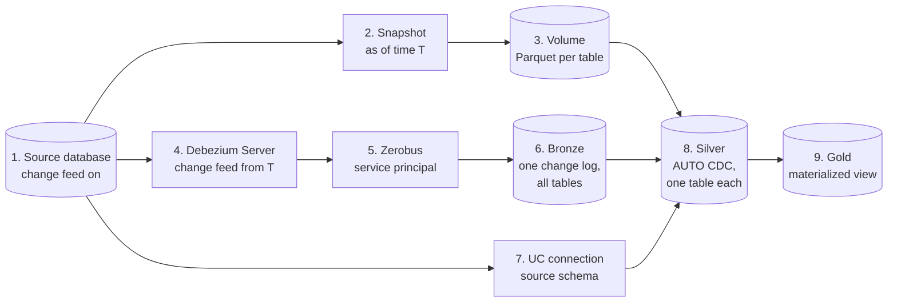
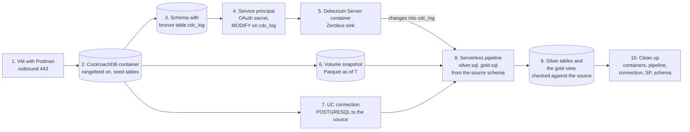

# Database changes through Zerobus: Debezium → bronze → silver → gold

A source database's changes stream through Debezium Server's Zerobus sink into one append-only bronze change log. Silver AUTO CDC tables are built from a snapshot and that log, and gold is a materialized view on silver. Each layer is checked against the source, row by row, after inserts, updates and deletes, a Debezium restart and an added column. It's for sources Lakeflow Connect doesn't cover, or for teams that want the change log itself as a bronze table. Back to the [README](../README.md).

Tested with CockroachDB v25.4.13 and Debezium Server 3.7.0.Final, on Podman on an Azure VM, into a serverless Azure workspace. The test is [zerobus-debezium-test](../skills/zerobus-debezium-test/SKILL.md).

## Tested end to end

| What was checked | Result (2026-10-20) |
|---|---|
| The snapshot stays out of the change log | ✅ No snapshot events; the feed starts at the snapshot time T |
| Inserts, updates and deletes reach bronze | ✅ Each as one `create`, `update` or `delete` event, within about 1 s |
| Silver equals the source | ✅ Every row of every table, after the first changes and after a second round (two updates of one key, a delete and reinsert, a reinsert of a deleted key, a decimal update) |
| Gold equals the source | ✅ After every round; the materialized view refreshes incrementally after the first update |
| Debezium killed and restarted | ✅ The stream resumes, and silver and gold stay right. The restart replays the changes since its last offset as new bronze rows, and AUTO CDC absorbs them |
| A column added on the source | ✅ It arrives in bronze with no Databricks DDL. Silver gets it after the flow is regenerated and that table is full-refreshed |
| Event size | ✅ 336 bytes per insert, down from 700 (52% smaller), with nothing silver needs lost |

The details, including what to watch for, are in the skill:
- **Don't deduplicate by `idempotency_key`:** with this connector it isn't unique per change.
- **The commit time isn't in the event:** silver sequences by Debezium's own clock.
- **`EXPORT INTO PARQUET` corrupts decimals:** the test exports them as text and casts them back.

## How the data moves



1. **Source database.** CockroachDB with rangefeeds on (`kv.rangefeed.enabled`). Debezium reads its changes through a sinkless changefeed, so no Kafka or cloud storage sits in between.
2. **Snapshot as of T.** One consistent dump of every table at one time T, from the database's own clock. It doesn't block writes.
3. **Volume.** The dump goes into a Unity Catalog volume, one folder of Parquet per table. A large first load never goes through the change feed or Zerobus.
4. **Debezium Server.** It reads the change feed starting at T and takes no snapshot of its own (`snapshot.mode=no_data`, the cursor at T). So the change log starts exactly where the snapshot ends. It needs only outbound 443 to Zerobus.
5. **Zerobus.** Debezium's Zerobus sink pushes each change over gRPC, as a service principal with `MODIFY` on the bronze table.
6. **Bronze.** One append-only Delta table, `cdc_log`, for every source table. Each event lands as `VARIANT` (`key`, `value`, position, headers), `CLUSTER BY (destination)`, the source table. A new source table or column needs no DDL here.
7. **UC connection.** Silver's columns, types and keys come from the source's `information_schema`, read through a Unity Catalog connection with `remote_query`. When the schema changes, it's read again.
8. **Silver.** One streaming table per source table, from two AUTO CDC flows. One reads the snapshot rows, sequenced by T. The other reads that table's events from bronze, sequenced by `value:ts_ns`, with deletes from `operation = 'delete'`. SCD type 1, clustered by the key.
9. **Gold.** A materialized view over silver, here each customer with the count and total of their orders. It refreshes incrementally once AUTO CDC's tables are in place.

**Why this shape:**
- **Fewer moving parts:** only Debezium Server runs between the database and the lakehouse, with no Kafka and no staging storage.
- **Bronze is only the change log,** so it's cheap to write, never rewritten, and replayable. Silver can be rebuilt from the snapshot and bronze at any time, which is how an added column is handled.
- **Small events:** fields silver doesn't need are dropped in Debezium (`DROP_FIELDS`), so each event is about half the size.

## What gets created, in order



Everything is named `<prefix>…<epoch>`, so runs never collide. The OAuth secret is never printed: it goes straight from the CLI's response into Debezium's settings file, mode 0600, and that file is deleted at the end. `KEEP=1` keeps everything for a look afterwards.

## The prompts, step by step

Each prompt is written the way you'd say it. The skills ask before creating anything; answer, then say yes.

**1. A VM with Podman** ([lfc-source-cloud-vm](../skills/lfc-source-cloud-vm/SKILL.md)):

> Create an Azure VM with Podman for Lakeflow Connect source tests, with outbound 443, and open ports 30000–30063 to my workspace's serverless egress IPs.

**2–10. The whole test** ([zerobus-debezium-test](../skills/zerobus-debezium-test/SKILL.md)):

> Run the Debezium to Zerobus test on that VM against the workspace for Databricks CLI profile <profile>, catalog <catalog>, through gold. Keep everything afterwards (KEEP=1) so I can look at the bronze, silver and gold tables, then show me the claim table.

**Just bronze, or just through silver:**

> Run the Debezium to Zerobus test with PHASE=1 and show me the change-log table and the bytes per event.

**What to look at, once kept:** in the run's schema, the following queries show each layer.
- **Bronze:** `SELECT destination, operation, value FROM cdc_log`.
- **Silver:** the `customers` and `orders` streaming tables.
- **Gold:** `SELECT * FROM customer_orders`.
- **How gold refreshed:** read the pipeline's event log for `planning_information` (`COMPLETE_RECOMPUTE` first, then incremental).

**Clean up:** remove the containers, the pipeline, the connection, the service principal and the schema. Do it when you're done looking at a `KEEP=1` run, or let a run without `KEEP=1` do it.

## Run it as a script

```bash
cd skills/zerobus-debezium-test
export PROFILE=<cli-profile> CATALOG=<catalog> VM_IP=<vm-ip>
C=/tmp/crdb-dbz-$(date +%s).sh; cp scripts/crdb-debezium-zerobus.sh $C && OUT=/tmp/crdb-dbz-result.md bash $C
```

`PHASE=1` stops after bronze and `PHASE=2` after silver. It exits 0 when every claim passed, 1 when one failed and 2 when a prerequisite is missing. Run a uniquely named copy, as above, so that editing the script can't change a run in progress. Record the result with `record.py` ([lfc-test-results](../skills/lfc-test-results/SKILL.md)).

**Next:** the same flow with YugabyteDB as the source.
